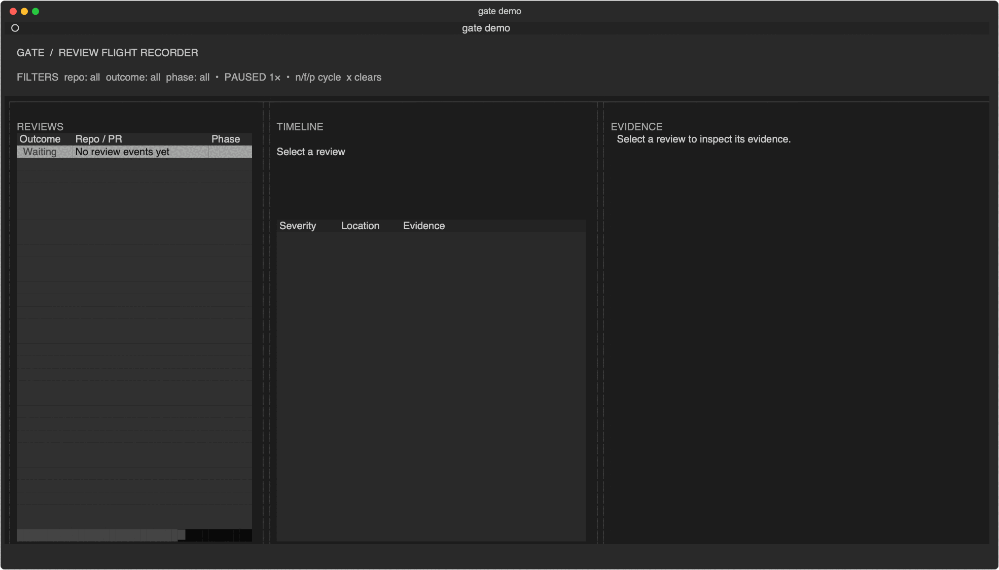

> **Project status — 2026-10-22:** Portfolio/interview preservation snapshot; not a new release or publication.
>
> This branch preserves the local implementation and documentation. Backup preparation did not rerun application tests, install software, call model providers, deploy a service or establish release readiness. Credentials and runtime state are excluded.

# Gate

Gate is a macOS-first review control plane and flight recorder for evidence-backed AI pull-request reviews. It coordinates focused review stages, preserves what each stage observed, and makes the complete decision trail explorable in a terminal UI.

Gate starts in **review-only mode**. Editing a branch requires an explicit per-repository opt-in, and pull requests from forks are refused before Gate creates a worktree or starts a model.



## Install and try the demo

```bash
uv tool install gate-review
gate --version
gate demo
```

Before the first public release, build and install the local artifact instead: `make package && uv tool install dist/gate_review-0.1.0-py3-none-any.whl`.

The bundled `risky-auth-refactor` scenario is synthetic, deterministic, and requires no credentials. It replays a risky authentication change through review, an explicitly opted-in simulated fix, a clean re-review, and a contradictory external check that blocks the final result for human attention.

```bash
gate demo --scenario risky-auth-refactor --speed 2
gate demo --headless --json
```

Expected machine-readable result:

```json
{"network_calls": 0, "outcome": "blocked", "scenario": "risky-auth-refactor", "valid": true}
```

Demo mode ignores real Gate configuration. It creates no sockets, state, worktrees, tmux sessions, subprocesses, or network clients.

## How a review works

```text
trusted same-repository PR
  -> triage and build evidence
  -> postconditions, architecture, security, and logic review
  -> evidence-backed verdict
  -> immutable review archive
  -> optional bounded fix (only when auto_fix = true)
  -> post-fix build and re-review
  -> external-check contradiction audit
```

Structured stages run through Claude by default. Agent review stages run in tmux. The optional fix pipeline uses Claude as the senior coordinator and Codex as the bounded editor. Typed runner protocols keep orchestration testable without exposing provider selection as a v0.1 configuration surface.

## Flight Recorder TUI

`gate up` opens the primary live TUI. `gate demo` opens the same recorder against bundled replay data.

- Dashboard: active and queued reviews, stage progress, elapsed time, review/fix mode, live logs, and compact health metrics.
- History: durable review archives ordered newest-first, including pre-fix/post-fix lineage and audit flags.
- Evidence: findings, severity, source location, evidence level, stage output, build/test results, fix summaries, and contradiction data.
- Responsive layouts: three panes at 140+ columns, two columns at 100–139, and one pane below 100.

Core keys:

| Key | Action |
|---|---|
| `d` / `h` | Dashboard / history |
| `Enter` / `Esc` | Open selected review / return |
| `r` | Refresh |
| `c` | Cancel selected active review |
| `o` | Open selected PR |
| `?` | Help |
| `q` | Quit |

Replay also supports `Space` to pause, arrow keys to seek, `+`/`-` to change speed, `Home` to reset, and `End` to finish immediately.

Historical archives are immutable. `gate cleanup` removes inactive PR state older than 30 days; `gate prune --reviews older-than=30d` performs explicit archive-only pruning.

## Trusted-source security boundary

Gate v0.1 executes only when the pull request head repository exactly matches the configured base repository. The check happens through GitHub's pull-request API before workspace creation, tmux, model execution, build commands, or repository scripts.

Forked pull requests receive an `action_required` status and an `untrusted` archive outcome. There is no v0.1 bypass. The packaged GitHub workflow applies the same repository equality guard.

Unexpected internal errors, circuit-breaker activation, quota failures, timeouts, and orphan cleanup never synthesize approval. `gate-skip` and `gate-emergency-bypass` remain explicit trusted-operator overrides and are intentionally visible in history.

See [Security](docs/security.md) and [SECURITY.md](SECURITY.md) before attaching Gate to a repository.

## Real review setup

Real Gate reviews are local-control, not offline: they contact GitHub and invoke the configured Claude and Codex CLIs.

Requirements:

- macOS and Python 3.11–3.14
- `tmux` 3.3+
- authenticated GitHub CLI (`gh`)
- authenticated Claude CLI (`claude`)
- Codex CLI (`codex`) only when auto-fix is enabled

Apple Silicon on macOS 26.5 is owner-verified. Other macOS versions and Intel Macs are currently unverified. Linux runtime operation is not supported in v0.1; the Ubuntu CI job is portable unit-test signal only.

```bash
gate init
gate doctor
tmux new 'gate up'
```

`gate init` writes the canonical configuration to `platformdirs.user_config_dir("gate")/gate.toml`—normally `~/Library/Application Support/gate/gate.toml` on macOS—and copies the packaged workflow into the selected repository. Set `GATE_CONFIG_PATH` for an explicit alternative.

If the canonical file is absent and a legacy checkout-local `config/gate.toml` exists, Gate atomically copies it, reports the migration once, leaves the legacy file untouched, and uses the canonical path afterward. Mutable state and logs remain under `platformdirs.user_data_dir("gate")`.

Minimal configuration:

```toml
[[repos]]
name = "owner/repository"
clone_path = "~/work/repository"
default_branch = "main"
project_type = "python"
auto_fix = false
```

## Review-only and auto-fix

`auto_fix = false` is the default and recommended starting point. Gate posts review evidence but does not edit or push the PR branch.

To opt a trusted repository into the existing bounded fix pipeline:

```toml
[[repos]]
name = "owner/repository"
auto_fix = true
```

Only then are fix mode, iteration limits, blocklists, checkpoints, validation, and `fix_on_approve_with_notes` consulted. Add `gate-no-fix` to a PR to disable fixing for that run even when the repository opted in.

## Commands

| Command | Purpose |
|---|---|
| `gate demo` | Replay the zero-credential signature scenario |
| `gate init` / `gate add-repo` | Generate configuration and install the packaged workflow |
| `gate up` / `gate up --headless` | Start the server with the TUI or headless integration mode |
| `gate status` / `gate cancel` | Inspect or cancel live work |
| `gate inspect-pr N --history` | Inspect durable review archives |
| `gate audit contradictions` | Inspect post-hoc external-check contradictions |
| `gate health` / `gate doctor` | Check runtime health and prerequisites |
| `gate cleanup` / `gate prune` | Apply documented retention and worktree cleanup |
| `gate update` | Print non-mutating `uv tool` and `pipx` upgrade guidance |

The local Unix-socket protocol remains the internal control surface. The authenticated SSE adapter is an advanced headless integration API; Gate does not ship a web Flight Deck or browser dashboard.

## Advanced Labs

Spec-test promotion and formal verification are experimental. `persist_spec_tests` remains false by default. Formal verification runs only when a verifier command is explicitly configured. Neither is part of normal setup, and both should be enabled first on low-risk repositories.

## Architecture and protocol

- [Protocol v1 and SSE integration API](docs/protocol.md)
- [Finding schema](docs/finding-schema.md)
- [External checks and contradiction audit](docs/external-checks.md)
- [Health and recovery](docs/health-and-recovery.md)
- [Metrics and retention](docs/metrics.md)
- [Notifications](docs/notifications.md)
- [Remote terminal operation](docs/remote-access.md)

Protocol v1 remains additive and backward compatible. Completed events may include `outcome = reviewed | skipped | cancelled | error | untrusted`; consumers can ignore it and continue using legacy `decision` values.

## Development

```bash
git clone https://github.com/openlawteam/gate.git
cd gate
uv sync --frozen --all-extras
uv run --frozen ruff format --check .
uv run --frozen ruff check .
uv run --frozen mypy gate
uv run --frozen pytest -q
make package
```

The test floor is 70% coverage. macOS CI covers Python 3.11–3.14, plus package installation and demo smoke checks. See [CONTRIBUTING.md](CONTRIBUTING.md) and [docs/releasing.md](docs/releasing.md).

Gate is licensed under the [MIT License](LICENSE).
